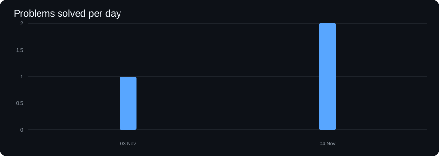
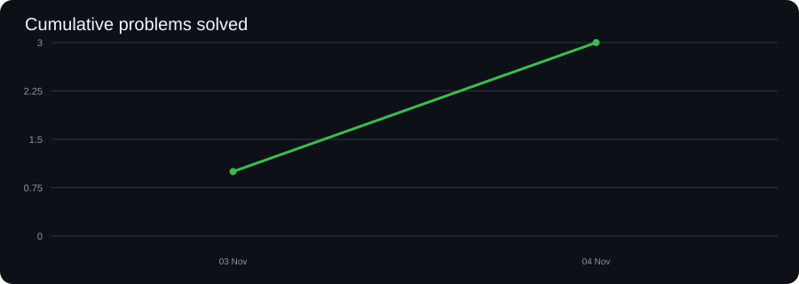

# DSA — Problem-Solving Journey

A record of my problem-solving practice in **LeetCode** and **Codeforces**, with notes on patterns, mistakes, and lessons learned.

## Progress dashboard

Tracking starts on **2026-11-03**. Historical solutions are not included. Only problems entered in `progress.csv` from this date count.

| Metric | Total |
|---|---:|
| LeetCode problems solved | 0 |
| Codeforces problems solved | 0 |
| Total problems solved | 0 |
| Active problem-solving days | 0 |
| Current streak | 0 days |
| Longest streak | 0 days |

### Daily progress



### Cumulative progress



## Repository structure

- `LeetCode/` — LeetCode solutions, organised by topic.
- `CodeForces/` — Codeforces solutions.
- `GeeksForGeeks/` — optional practice.
- `patterns/` — reusable problem-solving patterns and explanations.
- `Mistakes/` — mistakes, edge cases, and lessons to revisit.
- `progress.csv` — manual daily log for LeetCode and Codeforces.
- `scripts/update_progress.py` — regenerates statistics and SVG charts.

## How to log progress

Add **one row per date** to `progress.csv`:

```csv
date,leetcode_solved,codeforces_solved,notes
2026-11-03,1,1,"Solved one problem on each platform"
```

Rules:
- Count a problem only when its final solution is accepted.
- Count each problem once, on the date it was first solved.
- Enter `0` for a platform when no problem was solved there that day.
- Keep one row per date; update that row if you solve more problems later that day.

Regenerate the dashboard from the repository root:

```bash
python3 scripts/update_progress.py
```

Then commit the updated log, README, and charts:

```bash
git add README.md progress.csv assets/
git commit -m "Update DSA progress dashboard"
git push
```

The script uses only Python's standard library.

## Practice principles

- Understand the idea before coding.
- Analyse time and space complexity.
- Test edge cases before submitting.
- Record mistakes and the reasoning behind the corrected solution.
- Prefer consistent learning over chasing a daily count.
